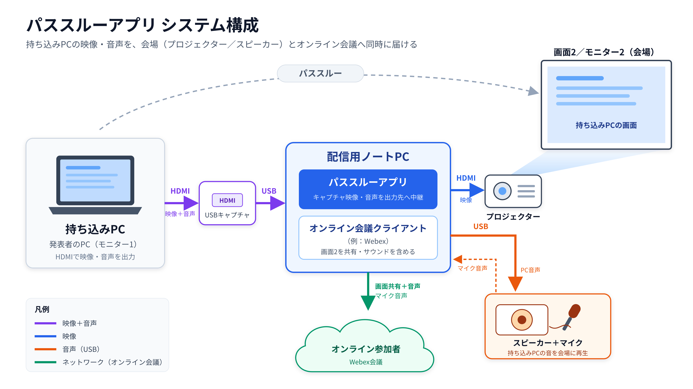
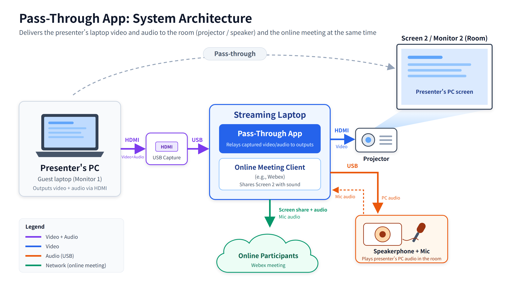

# パススルー表示 (Pass-Through Display)

会場の講演とオンライン会議を結ぶ**ハイブリッド配信を、手軽にする Windows アプリ**。
USB キャプチャーボードの映像・音声を、2台目のモニター（プロジェクター）へ
**超低遅延・自動フルスクリーン表示** します。

A Windows app that makes **hybrid (on-site + online) presentations easy**: it
shows a USB capture card's video/audio fullscreen on a second monitor
(projector) with **ultra-low latency**.

[English summary ↓](#english-summary)



## English Summary

**Why**: the guest presenter's laptop needs **no meeting app** — just an HDMI
output. The streaming laptop (which has the meeting client installed) runs this
app and shares the projector output (Screen 2) **with audio** in the meeting,
so online participants see and hear exactly what the room does.

**What**: `pass_through_gui` captures HDMI video/audio from a guest presenter's
PC through a USB capture card and displays it fullscreen on a projector
(second monitor) with minimal delay — designed for hybrid meetings where the
same PC also runs an online-meeting client (e.g. Webex).



**Requires**: Windows 10/11 x64 · DirectShow USB capture card — **for Mac
presenter laptops, use an HDCP-capable capture card** (Mac HDMI output enables
HDCP, which leaves regular capture cards black) · a second display / projector.

**Features**: ultra-low-latency pipeline (`nobuffer` / `low_delay` /
`framedrop` / `probesize 32k`) · device & monitor selection GUI · handles multiple
same-name capture devices · settings persisted to JSON · Japanese/English UI
switchable at runtime (default: Japanese) · single-file exe, no Python or
ffmpeg install required on target PCs.

**How to get it**: download `pass_through_gui.exe` from
[Releases](releases) and double-click it.

**License**: MIT (this app). Bundled FFmpeg binaries are GPLv3 — see
[THIRD_PARTY_NOTICES.md](THIRD_PARTY_NOTICES.md).

---

## このアプリの目的

会場の講演（参加者の**持ち込みPC**）とオンライン会議（Webex など）を結ぶとき、
次のことを不要にするためのアプリです。

- ❌ 持ち込みPC への**会議アプリのインストール・ログイン・音声設定**
- ❌ 配信機材の追加や、会場画面とは別の配信準備

仕組みは2つだけ:

1. **持ち込みPC側**: 自分のPCから **HDMI を出力するだけ**。会議アプリは不要で、
   講演者は普段どおり自分のPCでプレゼンできます
2. **配信用PC側**（会議アプリが入っているPC）: このアプリがキャプチャーした
   映像・音声をプロジェクター（= Screen 2）に全画面表示し、会議アプリで
   その **Screen 2 を「音声付き」で共有** します

これで**会場が見ている映像・音声を、オンライン参加者もそのまま視聴** でき、
ハイブリッド配信の準備が簡単になります。全体の配線は冒頭のシステム構成図を
参照してください。

```
持ち込みPC ──HDMI──> USBキャプチャー ──USB──> 配信用PC ──HDMI──> プロジェクター (Screen 2)
   (映像+音声のみ出力)                  (このアプリ)              │
                                                    会議アプリが
                                            「Screen 2 + 音声」を共有 ──> オンライン参加者
```

## 特徴

- **超低遅延**: ffplay を `nobuffer / low_delay / framedrop / probesize 32k`
  で起動し、キャプチャー表示の遅延を最小化します
- **1ファイル exe**: Python 本体・ffplay / ffmpeg を同梱。移行先 PC に
  Python・ffmpeg のインストールは**不要**
- **デバイス管理**: 映像/音声デバイスを GUI で選択。同じ名前のキャプチャー
  ボードを2台接続しても `(1) [ID]` `(2) [ID]` のように個別に判別・選択できます
- **設定の自動保存**: 選択内容は exe の隣の
  `pass_through_gui_config.json` に保存され、次回起動時に復元されます
- **日英切替**: 既定は日本語。画面最上部の「言語 / Language」で**再起動不要の
  即時切替**（英語: English）
- **モニター自動選択**: 表示先「自動」でプライマリ以外のモニター
  （＝プロジェクター）を自動的に選びます。ホットプラグにも追従します

## 動作環境

- Windows 10 / 11 (x64)
- USB キャプチャーボード（DirectShow 対応のもの）
- 2台目のディスプレイ or プロジェクター

### キャプチャーボードの選び方（重要）

持ち込みPC の OS によって、必要なボードが変わります。

| 持ち込みPC | 必要なキャプチャーボード |
|---|---|
| Windows | DirectShow 対応の一般的なボードで可 |
| **Mac** | **HDCP 対応ボードが必要**（Mac の HDMI 出力は HDCP が有効になるため、非対応ボードでは画面が黒くなって映りません） |

## 入手方法（exe）

1. このリポジトリの [Releases](releases) ページを開く
2. 最新の `pass_through_gui.exe` をダウンロード
3. exe を任意のフォルダに置いてダブルクリック（1ファイルで動きます）

## 使い方

1. `pass_through_gui.exe` をダブルクリックで起動
2. USB キャプチャーボードを接続（挿し直した後は **[再検出]** ボタンで一覧更新）
3. **映像デバイス** / **音声デバイス** を選択
4. **解像度・FPS・表示先** を確認（初期値は「自動（デバイス推奨）」、表示先は
   「自動（プライマリ以外＝プロジェクター）」）
5. 必要ならチェックボックス調整: フルスクリーン / 音声も出力 / 低遅延(最速)
6. **[▶ 開始]** でプロジェクター側にフルスクリーン表示
7. 終了は ffplay 画面で **Esc**、または **[■ 停止]** ボタン

> **ハイブリッド配信の手順**: 配信用PC の会議アプリ（Webex など）で
> **Screen 2（プロジェクター側）を「音声付き」で画面共有** すると、会場と
> 同じ映像・音声がオンラインへそのまま配信されます。

> **言語の切り替え**: 既定は日本語です。画面上部の「言語 / Language」コンボで
> English に切り替えると、UI 全体が即時に英語へ変わります（設定は保存され、
> 次回起動時も引き継がれます）。

## 低遅延の設定について

「低遅延(最速)」チェック ON（既定）では以下の ffplay オプションが有効です:

```
-fflags nobuffer -flags low_delay -framedrop -probesize 32k -analyzeduration 0
```

- 解像度・FPS は初期値「自動（デバイス推奨）」が最も安全です
- 対応外の組み合わせ（例: 60fps 非対応デバイスに 60fps）を選ぶと、起動直後に
  エラー内容がダイアログで表示されます。値を変えて再試行してください

## ソースからのビルド

exe を自前でビルドする場合:

1. ffmpeg (win64 shared build) を用意し、そのディレクトリを environment
   variable `FFMPEG_BIN` に設定（既定: `C:/ffmpeg/bin`）。
   `ffplay.exe` / `ffmpeg.exe` が必要
2. 依存ツールをインストール:
   ```
   pip install -r requirements.txt
   ```
3. ビルド:
   ```
   python -m PyInstaller --noconfirm --clean pass_through_gui.spec
   ```
4. 出力: `dist/pass_through_gui.exe`（設定ファイルは exe の隣に生成されます）

> 実行自体に外部ライブラリは不要です（Python 標準ライブラリのみ）。
> `requirements.txt` はビルドツール（PyInstaller）専用です。

## テスト

```
python -m unittest test_pass_through_logic.py -v   # ロジック単体テスト
python pass_through_gui.py --selftest              # 環境セルフチェック
python pass_through_gui.py --debug                 # ffplay 起動コマンドを表示（起動しない）
```

## トラブルシューティング

| 症状 | 対処 |
|---|---|
| Mac 持ち込みPC で画面が黒い・映らない | Mac の HDMI 出力は HDCP が有効です。**HDCP 対応キャプチャーボード**をお使いください |
| 「Could not run graph / device already in use」 | OBS・カメラアプリ等がキャプチャーデバイスを使用中です。先に終了してください |
| 起動直後にエラーダイアログ | 解像度・FPS を「自動」に戻して再試行 |
| 一覧にデバイスが出ない | キャプチャーボードを挿し直して **[再検出]** をクリック |
| 同じ名前のボードが複数 | `(1) [ID]` `(2) [ID]` と表示されます。`[ID]` で個体を判別できます |
| exe の起動に数秒かかる | onefile 形式が毎回一時フォルダへ展開するため（仕様） |
| セキュリティソフトが警告 | PyInstaller 製 exe の誤検知です。必要なら「許可」してください |
| プロジェクターが映らない | 表示先コンボで明示的にモニターを選ぶ（「自動」は非プライマリを選択） |

## 翻訳の追加方法（Contributing）

`pass_through_gui.py` の `TRANSLATIONS` 辞書に新しい言語エントリを1つ追加する
だけです:

```python
TRANSLATIONS["fr"] = {"button.start": "▶ Démarrer", ...}
LANGUAGES["fr"] = "Français"
```

未訳キーは自動的に日本語へフォールバックするため、部分翻訳から始められます。
PR を歓迎します。

## ライセンス

- 本アプリ: [MIT License](LICENSE) © 2026 tknao
- 同梱 FFmpeg バイナリ: GPL v3 — 開示事項は
  [THIRD_PARTY_NOTICES.md](THIRD_PARTY_NOTICES.md) を参照
